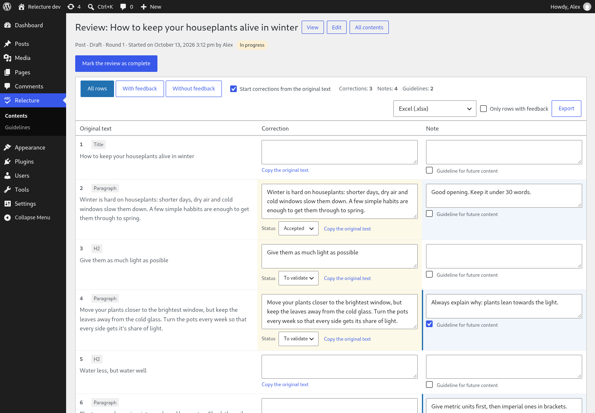

# Relecture

**Proofread, correct and annotate WordPress posts and pages in a three-column table, then
export the review to Excel, CSV, Word, Markdown or JSON.**

Relecture (French for “proofreading”) lays out the title and every text block of a content
in a table — **original text · correction · note** — saved as you type. The content itself is
never changed: a review is a separate snapshot that you hand over to a proofreader, a client
or an AI, and apply when you decide to. Notes flagged as **guidelines** are gathered across
reviews, ready to feed the instructions of your next articles.

> Full functional and technical specification (in French):
> [docs/cahier-des-charges.md](docs/cahier-des-charges.md).

## Features

- **Review table** for posts, pages, synced patterns and public post types using the editor
  (block or classic): headings, paragraphs, list items, quotes and their source, pullquotes,
  buttons, captions, alternative texts, table cells, details, verse, custom HTML text.
  Code, shortcodes and dynamic blocks are left out.
- **Autosave** through the REST API, with an optimistic lock: two people editing the same
  row never overwrite each other silently.
- **Correction statuses** (to validate, accepted, rejected, applied) and **review rounds**
  (in progress → review complete → corrections applied, read-only).
- **Snapshot sync**: when the content changes, Relecture says so and can re-read it while
  keeping each correction and note attached to its text.
- **Guidelines page**: every note ticked “guideline for future content”, with bulk “mark as
  integrated”, exported as Markdown, CSV or JSON.
- **Exports**: Excel (.xlsx), CSV (UTF-8, locale-aware separator), Word (.docx, A4
  landscape), Markdown and JSON. Written without any external library.
- **REST API and WP-CLI** for scripts and AI agents.
- **No external request, no tracking.** English source strings, French translation bundled.

Requires WordPress 6.5+ and PHP 7.4+ (tested on WordPress 6.5 and 7.1, PHP 7.4 lint and 8.3).



## Install

Download or build `relecture-<version>.zip` (see [Development](#development)), then
**Plugins → Add New → Upload Plugin**. Open **Relecture** in the admin menu, or use the
**Review** link under a post in the Posts and Pages lists.

## Working with an AI or a script

Every row of an export carries its block name and its index path in the block tree, plus
the source HTML in JSON: enough to find the text in the database or in the files the
content is generated from.

### WP-CLI

```bash
wp relecture start 42                                   # snapshot of post 42
wp relecture export 42 --format=md --only-with-feedback # corrections and notes, as Markdown
wp relecture export 42 --format=json > review.json      # same data, structured
wp relecture export 42 --format=docx --output=review.docx
wp relecture set-item-status 118 119 --correction=applied
wp relecture set-status 7 done
wp relecture guidelines --status=new --format=md        # guidelines not yet integrated
wp relecture list --status=ready
```

### REST API (`/wp-json/relecture/v1`)

Authenticate with an [application password](https://make.wordpress.org/core/2020/11/05/application-passwords-integration-guide/).
Every route checks that the user can edit the reviewed content.

| Method | Route | Purpose |
| --- | --- | --- |
| `GET` | `/reviews?post_id=&status=` | List reviews |
| `POST` | `/reviews` `{"post_id": 42}` | Open (or start) the review of a post |
| `GET` | `/reviews/<id>` | Review and rows (same structure as the JSON export) |
| `PATCH` | `/reviews/<id>` `{"status": "done"}` | Change the status |
| `POST` | `/reviews/<id>/resync` | New snapshot, feedback kept |
| `GET`, `PATCH` | `/items/<id>` `{"correction": "…", "expected_version": 3}` | Read or change a row |
| `GET` | `/guidelines?status=new` | Guidelines |

A `PATCH` with a stale `expected_version` answers `409`: reload the row and try again.

## For developers

| Hook | Type | Use |
| --- | --- | --- |
| `relecture_post_types` | filter | Post types that can be reviewed |
| `relecture_can_review` | filter | Who may review a post (default: `edit_post`) |
| `relecture_excluded_blocks` | filter | Blocks skipped by the extraction |
| `relecture_block_segments` | filter | Rows of one block (for blocks storing text in attributes) |
| `relecture_post_segments` | filter | All rows of a post (add custom fields…) |
| `relecture_csv_delimiter` | filter | CSV separator |
| `relecture_review_started` | action | A review was started |
| `relecture_item_updated` | action | A row changed |
| `relecture_review_status_changed` | action | A review changed status |

Data lives in two tables, `{prefix}relecture_reviews` and `{prefix}relecture_items`, removed
on uninstall (define `RELECTURE_KEEP_DATA` to keep them).

## Development

Requirements: Podman with podman-compose; for the checks, `unzip`, `xmllint`, LibreOffice
(`soffice`), `msgfmt`/`msgmerge`.

```bash
cd dev && podman-compose up -d && ./setup.sh   # WordPress 7.1.3 + test content → http://localhost:8090
cd ..
podman exec relecture_dev_cli wp eval-file wp-content/plugins/relecture/tests/smoke.php
tests/check-exports.sh                          # exports opened by independent tools
tests/security.sh                               # REST permissions, with application passwords
podman exec relecture_dev_cli wp plugin check relecture \
  --exclude-directories=dev,tests,docs,scripts,dist,vendor,.git,.wordpress-org \
  --exclude-files=.editorconfig,.gitattributes,.distignore,.gitignore,phpcs.xml.dist,README.md,CHANGELOG.md,SECURITY.md
podman run --rm -v "$PWD":/app:z -w /app docker.io/library/composer:2 sh -c 'composer install && vendor/bin/phpcs'
scripts/i18n.sh                                 # .pot, then fr_FR .mo / .l10n.php / .json
scripts/build-zip.sh                            # dist/relecture-<version>.zip
```

`.wordpress-org/` holds the directory assets (icon, screenshots). To refresh the screenshots,
start an English instance seeded with `dev/screenshots.php`:

```bash
cd dev
RELECTURE_ENV=shots RELECTURE_PORT=8092 podman-compose -p relecture-shots up -d
RELECTURE_ENV=shots RELECTURE_PORT=8092 WP_LOCALE=en_US RELECTURE_SEED=screenshots ./setup.sh
```

The test accounts' passwords are written to `dev/.credentials-dev` (git-ignored). No build
step: `assets/` holds the files WordPress loads.

## Roadmap

- **1.1**: word-level diff, visible non-breaking spaces, Abilities API (AI agents through
  MCP), personal data exporter and eraser, continuous integration.
- **2.0**: apply accepted corrections from WordPress (with a revision), AI review through
  the WordPress 7.0+ AI client, Word export with tracked changes, CSV/XLSX import, review
  links for people without an account, sync with the editor's Notes.

## License

[GPLv2 or later](LICENSE). Report security issues privately, see [SECURITY.md](SECURITY.md).
